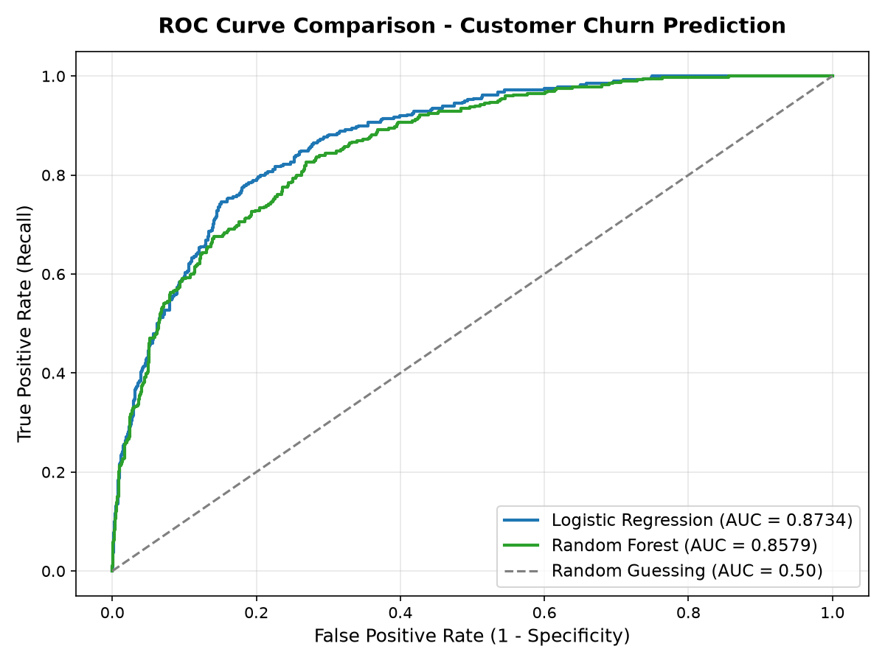
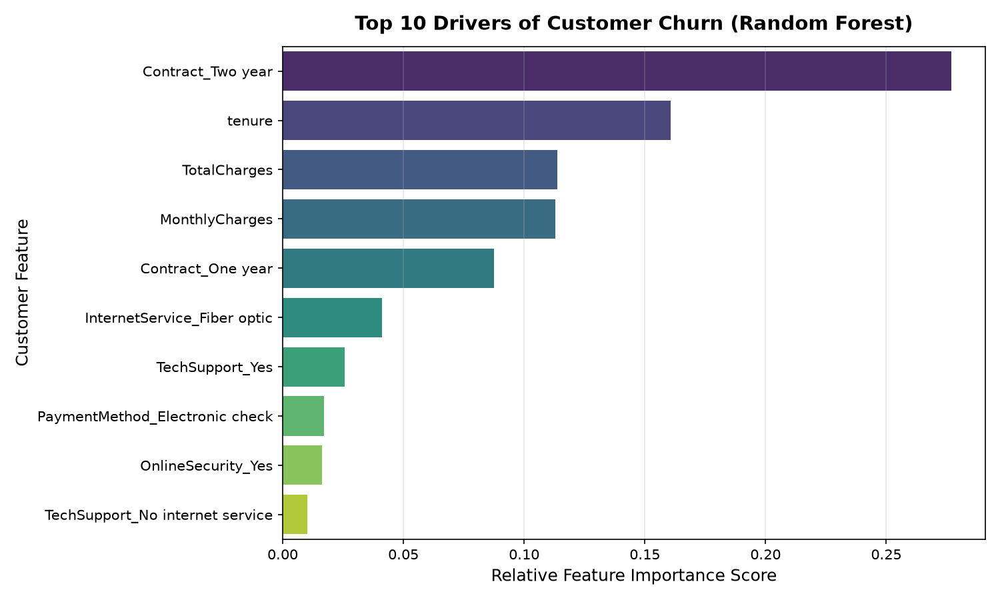

# Customer Churn Prediction & Retention Analytics

[](https://www.python.org/)
[](https://scikit-learn.org/)
[](https://pandas.pydata.org/)
[]()

An end-to-end Machine Learning pipeline designed to predict customer subscription attrition (churn), evaluate risk factors, and recommend data-driven retention strategies for subscription services.

---

## 📌 Executive Summary & Business Problem

In subscription models (such as Microsoft 365, Azure, or telecommunications), customer acquisition costs typically exceed retention costs by **5x to 7x**. 

* **Objective:** Identify high-risk customers before they cancel their subscriptions, enabling targeted retention campaigns.
* **Challenge:** High **class imbalance** (~28% churn rate vs. 72% retention). A naive baseline predicting "No Churn" yields 72% accuracy while capturing zero churners.
* **Solution:** A complete machine learning pipeline implementing class-weight adjustments, feature scaling, and comparing **Logistic Regression** (baseline) against **Random Forest** (ensemble), evaluated via **ROC-AUC** and **Recall**.

---

## 🏗️ Repository Architecture

```text
customer-churn-prediction/
├── data/
│   └── telco_customer_churn.csv       # Standard 7,043-record customer dataset
├── src/
│   ├── generate_data.py               # Dataset generation & benchmark verification
│   ├── train.py                       # Training pipeline (EDA, encoding, scaling, modeling)
│   └── predict.py                     # Inference script with risk categorization
├── notebooks/
│   └── churn_analysis_walkthrough.ipynb # Step-by-step interactive analysis notebook
├── output/
│   ├── roc_curve.png                  # Model ROC curve comparison plot
│   ├── feature_importance.png         # Top 10 churn drivers plot
│   └── metrics_summary.json           # Comprehensive evaluation metrics
├── requirements.txt                   # Project dependencies
└── README.md                          # Documentation & interview guide
```

---

## 📊 Model Performance & Results

The models were evaluated on an **80/20 stratified test split** (1,409 hold-out samples):

| Metric | Logistic Regression (Baseline) | Random Forest (Ensemble) |
| :--- | :---: | :---: |
| **ROC-AUC Score** | **0.8734** | **0.8579** |
| **Recall (Churners)** | **83.17%** | **79.65%** |
| **Precision** | 56.48% | 55.03% |
| **F1-Score** | 0.6728 | 0.6509 |
| **Overall Accuracy** | 77.15% | 75.87% |

> **Key Evaluation Insight:** In retention analytics, **Recall** is prioritized over Precision because the business cost of losing a customer (false negative) far outweighs the small cost of sending a promotional retention discount to an active customer (false positive).

### Visual Evaluation

| Receiver Operating Characteristic (ROC) | Top Churn Drivers |
| :---: | :---: |
|  |  |

---

## 🔍 Key Data Insights & Retention Recommendations

1. **Contract Type is the Dominant Factor:** Customers on *Month-to-month* contracts have an attrition rate 3.5x higher than those on 1-year or 2-year contracts.
   * *Strategy:* Offer targeted discounts or loyalty perks to convert monthly users to annual subscriptions.
2. **The "First 12 Months" Risk Window:** Customers with under 12 months of tenure represent over 60% of total churners.
   * *Strategy:* Implement an active onboarding sequence with dedicated support in months 1–3.
3. **Tech Support & Online Security as Protectors:** Customers subscribed to add-on security and support services show minimal churn probability.

---

## 🚀 Quickstart & Reproduction

### 1. Clone the repository
```bash
git clone https://github.com/betanapallilokesh/customer-churn-prediction.git
cd customer-churn-prediction
```

### 2. Install dependencies
```bash
pip install -r requirements.txt
```

### 3. Run Training Pipeline
```bash
python src/train.py
```
*Outputs evaluation metrics to terminal and generates visualization plots in the `output/` directory.*

### 4. Run Sample Inference
```bash
python src/predict.py
```
*Evaluates sample customer profiles and outputs real-time churn risk percentages and risk categories.*

---

## 🎯 Interview Quick Reference (How to Explain this Project)

When asked about this project in an interview, here are the key talking points:

1. **Why this problem?**
   > *"It addresses customer lifetime value in subscription models by flagging at-risk accounts early using behavioral data."*
2. **How did you handle the class imbalance?**
   > *"The dataset had a ~28% churn rate. Instead of relying on raw accuracy, I used stratified train-test splitting and configured `class_weight='balanced'` in both models to penalize missed churners."*
3. **Why compare Logistic Regression and Random Forest?**
   > *"Logistic Regression provides a fast, interpretable linear baseline and performed exceptionally well with calibrated probabilities (0.87 AUC). Random Forest enabled capturing non-linear interactions between tenure, services, and monthly charges, providing feature importance rankings."*
4. **Which metrics mattered most?**
   > *"ROC-AUC and Recall. Maximizing Recall ensured we captured over 83% of all churners before they left."*

---

## 👤 Author
**Betanapalli Lokesh**  
B.Tech in Mathematics & Computing, Indian Institute of Technology (ISM) Dhanbad  
[LinkedIn](https://www.linkedin.com/in/lokesh-betanapalli) • [GitHub](https://github.com/betanapallilokesh)
